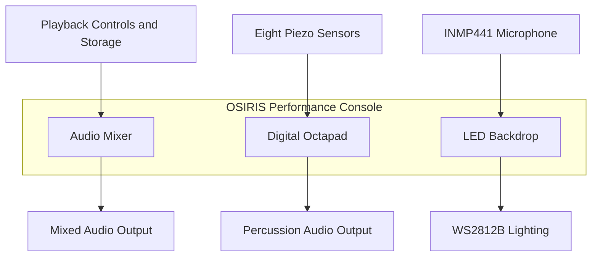

# OSIRIS
### Integrated Performance Console

**Audio mixing · Digital percussion · Reactive lighting**

Three embedded subsystems brought together in one portable performance console.

**ESP32 | Embedded Systems | Analog Audio | Hardware Integration**

[Overview](#overview) · [Architecture](#system-architecture) · [Repository](#repository-structure) · [Setup](#getting-started) · [Team](#team)

---

## Overview

OSIRIS is an integrated hardware project combining a dual channel audio mixer, an eight pad digital percussion system, and a music reactive LED backdrop.

Developed by a five member team during our first year at the University of Moratuwa, the project explores how microcontroller firmware, analog electronics, sensor inputs, and visual outputs can work together in a single physical system.

The design distributes processing across separate microcontrollers, allowing each subsystem to handle its own workload while operating within a shared console.

## Core Modules

| Module | Purpose | Key capabilities |
| :--- | :--- | :--- |
| **Audio Mixer** | Audio playback and mixing | Dual channel control, analog tone adjustment, faders, rotary encoder input, and microSD playback |
| **Digital Octapad** | Live percussion input | Eight piezo sensor pads, strike intensity detection, instrument selection, and OLED feedback |
| **LED Backdrop** | Audio responsive visuals | Microphone input, FFT frequency analysis, automatic gain control, and multiple lighting effects |

These capabilities describe the prototype documented in our project report. Firmware setup and hardware details are maintained alongside each module as they are added to this repository.

## System Architecture

The console follows a distributed embedded architecture with dedicated processing for audio, percussion, and lighting.

The diagram shows subsystem responsibilities rather than electrical connections. The LED backdrop responds to microphone input; it does not require a shared digital timing signal between modules.

## Engineering Focus

### Embedded firmware
Handling physical inputs, coordinating peripheral devices, and controlling audio and visual outputs.

### Analog and digital integration
Combining microcontroller based control with analog audio processing, conversion, and amplification.

### Sensor processing
Detecting percussion strikes and translating physical input into responsive instrument behavior.

### Audio analysis
Using frequency analysis to drive lighting patterns from the surrounding audio.

### System integration
Bringing independently developed modules into one enclosure and evaluating their combined behavior.

## Hardware

| Component | Role |
| :--- | :--- |
| ESP32 / ESP-WROOM-32 | Embedded processing |
| PCM5102 DAC | Digital to analog audio conversion |
| MicroSD module | Audio storage |
| PAM8403 amplifier | Audio amplification |
| Piezo sensors | Percussion strike detection |
| CD74HC4067 | Analog input multiplexing |
| OLED display | Instrument and pad feedback |
| Rotary encoders | Navigation and playback input |
| INMP441 microphone | Digital audio input for lighting |
| WS2812B LEDs | Addressable visual output |

Exact quantities, GPIO assignments, supply requirements, and circuit revisions should be verified against the assembled hardware.

## Repository Structure

The repository is organized around the three firmware modules, with supporting hardware documentation and validation records.

| Path | Contents |
| :--- | :--- |
| `firmware/audio-mixer/` | Audio mixer source and setup instructions |
| `firmware/octapad/` | Percussion source and calibration details |
| `firmware/led-backdrop/` | Lighting source and configuration |
| `hardware/` | Schematics, PCB designs, enclosure files, and component lists |
| `docs/` | Architecture notes, setup guides, photos, and project report |
| `tests/` | Hardware test procedures and results |

For Arduino sketches, the main sketch filename must match its containing folder. For example:

`firmware/octapad/octapad.ino`

## Getting Started

### 1. Select a module

Start with the subsystem you want to build or inspect:

- `firmware/audio-mixer/`
- `firmware/octapad/`
- `firmware/led-backdrop/`

### 2. Check its configuration

Each module should document:

- Target board and hardware revision
- Development environment and board package version
- Required libraries and their versions
- GPIO connections and power requirements
- Build and upload instructions
- Required audio files or other assets
- Calibration and configuration steps

### 3. Verify independent operation

Build, upload, and test each subsystem separately before connecting the complete console.

### 4. Validate the integrated system

Follow the verified wiring and audio routing documentation, then check the combined behavior of all three modules.

> Reproducible build instructions will be finalized when the firmware and its exact dependencies are published.

## Testing and Validation

The project report documents subsystem testing and system integration. This repository will maintain reproducible procedures and supporting evidence as those records are added.

| Area | Validation focus |
| :--- | :--- |
| Audio mixer | Playback, control response, channel behavior, clipping, and noise |
| Octapad | Pad detection, strike intensity, repeated hits, and crosstalk |
| LED backdrop | Audio response, lighting modes, brightness, and LED mapping |
| Complete system | Power stability, interference, and sustained operation |

Test records should identify the firmware revision, hardware configuration, method, and actual result. Timing and performance claims require measured evidence.

## Project Status

**Academic hardware prototype completed · Repository documentation in progress**

The prototype is documented in the final project report. Repository work focuses on making its implementation easier to inspect, reproduce, and maintain.

## Team

**Team OSIRIS · Group 08**  
University of Moratuwa  
First Year · IN1901: Microcontroller Based Application Development

| **Member** | **GitHub** |
| :--- | :--- |
| Wijesiri KSK | [@kaushalyawijesiri0-lang](https://github.com/kaushalyawijesiri0-lang) |
| Jayanath SP | [@jayanathsp-24](https://github.com/jayanathsp-24) |
| Nuwanjana HMM | [@MNuwanjana](https://github.com/MNuwanjana) |
| Gunasekara MIT | [@inusha-thathsara](https://github.com/inusha-thathsara) |
| Dinisuru PWL | [@Dinisuru-PWL](https://github.com/Dinisuru-PWL) |

**Supervisor:** Mr. B. H. Sudantha

## License

A repository license has not yet been selected. Reuse permissions for firmware, hardware designs, and media will be documented once agreed upon by the contributors.

## Related Repositories

### AirDJ Mobile Application

A companion mobile application developed for the Air DJ system, featuring Bluetooth connectivity, device monitoring, playlist management, and LED-related telemetry visualization.

The application was developed as a separate component during the project.

**Repository:** [AirDJ Mobile App](https://github.com/inusha-thathsara/air_dj)

---

**OSIRIS**  
Sound. Rhythm. Light.

